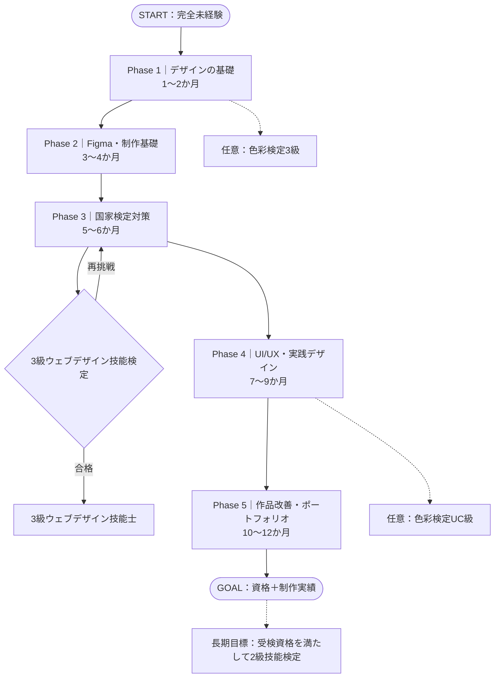
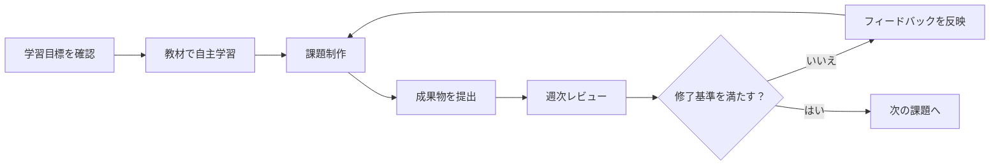

# Stella Roadmap

> **ゼロから、Webデザイナーへ。**
>
> デザイン・プログラミング未経験者が、自主学習と定期レビューを通じて、デザインの基礎・Web制作の知識・実践的な制作力を身につけるための学習ロードマップです。

## 🎯 目的とゴール

**中間目標：国家検定「3級ウェブデザイン技能士」の取得**  
**最終目標：目的と制作意図を説明できるWebサイト作品とポートフォリオを完成させること**

資格は知識・技能を確認するマイルストーン、ポートフォリオは実践力を示す成果物として位置づけます。資格取得だけが目的にならないよう、学習と制作を並行して進めます。

### 対象者と学習条件

| 項目 | 内容 |
| --- | --- |
| 対象 | デザイン・プログラミング完全未経験者 |
| 学習形式 | 自主学習中心＋指導者による週1回のレビュー |
| 学習時間の目安 | 週5〜8時間 |
| 期間の目安 | 約12か月（進捗に応じて調整） |
| 主な制作ツール | Figma |
| 補助的な知識 | HTML / CSS、アクセシビリティ、情報設計 |
| 最終成果物 | オリジナルWebサイトのデザイン＋ポートフォリオ |

> この期間は教育計画上の目安です。12か月で就職や実務レベルへの到達を保証するものではありません。

## 🗺️ ロードマップ

**注意：** 資格試験の申込・結果待ち・再受検によって、その後のデザイン学習を止める必要はありません。試験対策と実制作は並行して進められます。

## 📚 Phase別の学習内容

| Phase | 時期の目安 | 主な学習内容 | 成果物・修了目標 | Issue |
| --- | --- | --- | --- | --- |
| **1. デザイン基礎** | 1〜2か月 | デザイン4原則、配色、文字、余白、サイト分析 | デザイン意図を言語化できる | [#2](https://github.com/UtakataKyosui/stella-roadmap/issues/2)・[#3](https://github.com/UtakataKyosui/stella-roadmap/issues/3) |
| **2. 制作基礎** | 3〜4か月 | Figma、模写、ワイヤーフレーム、HTML/CSS入門 | LP模写・簡易ワイヤーフレームを完成 | [#4](https://github.com/UtakataKyosui/stella-roadmap/issues/4)・[#5](https://github.com/UtakataKyosui/stella-roadmap/issues/5) |
| **3. 国家検定対策** | 5〜6か月 | 3級の学科・実技範囲、演習、模擬試験 | 3級ウェブデザイン技能検定の受検・合格 | [#6](https://github.com/UtakataKyosui/stella-roadmap/issues/6)・[#7](https://github.com/UtakataKyosui/stella-roadmap/issues/7) |
| **4. 実践デザイン** | 7〜9か月 | UI/UX、情報設計、アクセシビリティ、レスポンシブ | PC・スマホ対応のオリジナルサイトを設計 | [#8](https://github.com/UtakataKyosui/stella-roadmap/issues/8)・[#9](https://github.com/UtakataKyosui/stella-roadmap/issues/9) |
| **5. ポートフォリオ** | 10〜12か月 | レビュー改善、ケーススタディ、成果発表 | 作品と制作プロセスを公開・説明できる | [#10](https://github.com/UtakataKyosui/stella-roadmap/issues/10) |

週次レビューと修了判定の共通運用は [Issue #11](https://github.com/UtakataKyosui/stella-roadmap/issues/11) を参照してください。

## 🏅 資格取得の方針

| 資格 | 位置づけ | 学習で重視すること |
| --- | --- | --- |
| **3級ウェブデザイン技能士** | **主要な到達目標（国家検定）** | Web関連知識・実技を体系的に学ぶ |
| 色彩検定3級 | 任意・基礎の補強 | 色彩理論や配色の理解 |
| 色彩検定UC級 | 任意・発展学習 | 色覚の多様性と見やすさ |
| 2級ウェブデザイン技能士 | 長期的な発展目標 | 実践力の向上と、受検資格を満たした後の挑戦 |

ウェブデザイン技能検定は国家検定ですが、合格だけでデザインの実務能力すべてが証明されるわけではありません。作品制作と振り返りを必須にします。また、2級には受検資格があるため、挑戦前に条件を確認します。

- [ウェブデザイン技能検定（公式）](https://www.webdesign.gr.jp/)
- [色彩検定（公式）](https://www.aft.or.jp/)

※受検資格・試験日・申込期間・出題範囲・受検料は変更されることがあります。必ず受検時点の公式案内を確認してください。

## 🔁 学習・レビューの進め方

### 学習者が行うこと

1. 対応するIssueの「学習内容」「提出物」「受け入れ条件」を読む。
2. 教材で学び、課題を制作する。
3. 制作物とともに**制作意図・参考資料・工夫した点・疑問点**を共有する。
4. レビューを受けて改善し、修了条件を満たしたら次へ進む。

### 指導者が行うこと

1. 週1回を目安に成果物をレビューする。
2. 「好み」ではなく、**目的適合性・情報設計・視覚デザイン・使いやすさ・説明力**を根拠に評価する。
3. 修正方法を一方的に伝えるだけでなく、判断の理由を本人に説明してもらう。
4. 進捗と理解度に応じて課題の難易度や学習期間を調整する。

### レビュー観点（配点例）

| 観点 | 配点 |
| --- | ---: |
| 目的・ターゲットへの適合性 | 25 |
| 情報の優先順位・構成 | 25 |
| 配色・文字・余白などの視覚表現 | 20 |
| 使いやすさ・アクセシビリティ | 20 |
| 制作意図の説明・改善力 | 10 |
| **合計** | **100** |

配点はあくまで参考です。Phase 1の課題を、最終制作課題と同じ厳しさで採点する必要はありません。

## ✅ Issueによる進捗管理

- **[Epic #1：Webデザイナー育成ロードマップ](https://github.com/UtakataKyosui/stella-roadmap/issues/1)**：全体目標とPhase一覧
- [#2〜#3：デザイン基礎](https://github.com/UtakataKyosui/stella-roadmap/issues/2)
- [#4〜#5：制作基礎](https://github.com/UtakataKyosui/stella-roadmap/issues/4)
- [#6〜#7：国家検定](https://github.com/UtakataKyosui/stella-roadmap/issues/6)
- [#8〜#9：実践デザイン](https://github.com/UtakataKyosui/stella-roadmap/issues/8)
- [#10：ポートフォリオ](https://github.com/UtakataKyosui/stella-roadmap/issues/10)
- [#11：レビュー・修了判定](https://github.com/UtakataKyosui/stella-roadmap/issues/11)

各Issueには、学習内容・提出物・受け入れ条件をまとめます。成果物の更新やレビュー結果もIssueに記録すると、成長過程を追跡できます。

## 🏁 最終修了条件

- [ ] デザインの基本原則を、作品の具体例を使って説明できる
- [ ] FigmaでWebページを設計・制作できる
- [ ] 3級ウェブデザイン技能検定の学科・実技に合格する
- [ ] PC・スマートフォンに対応したオリジナルWebサイトをデザインする
- [ ] レビューを受けて改善した履歴を残す
- [ ] ポートフォリオを完成させ、制作の目的・判断・改善過程を説明できる

---

**学ぶ → 作る → 説明する → 改善する。** この繰り返しを通じて、根拠を持ってデザインできるようになることを目指します。
